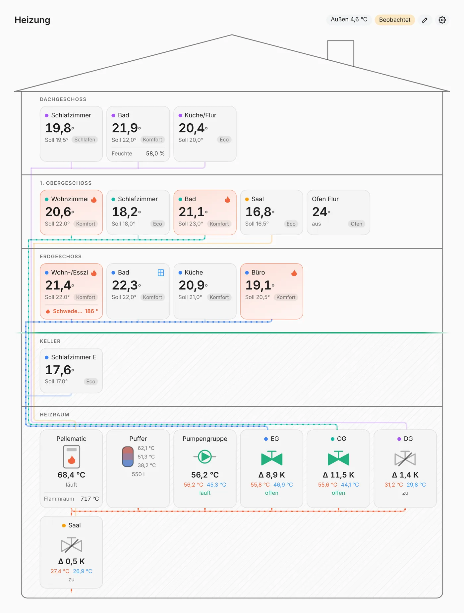
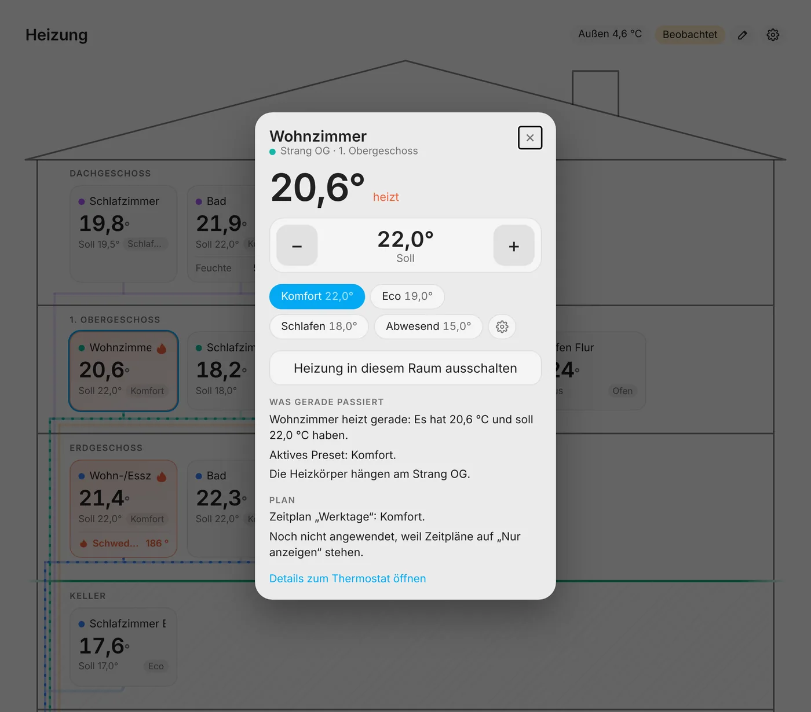
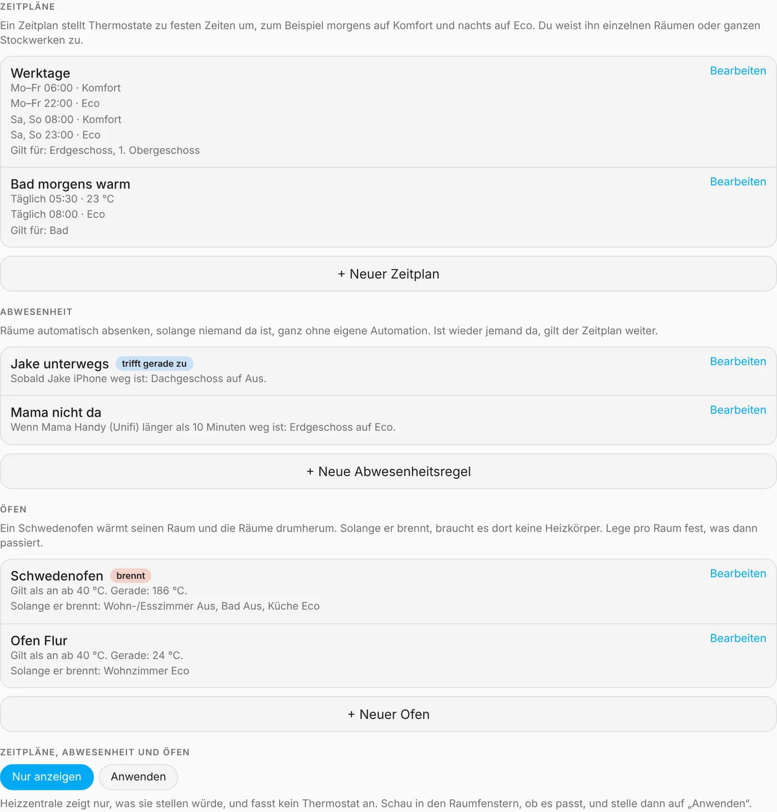
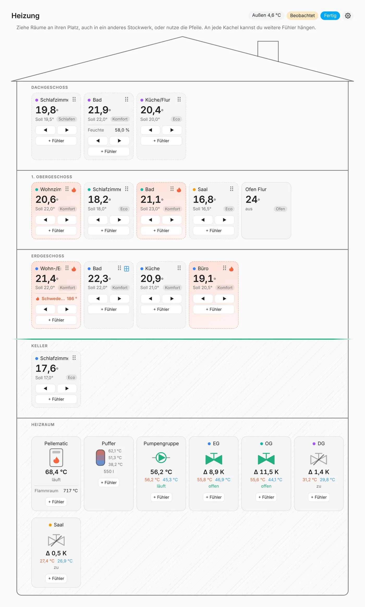

# Heizzentrale

[](https://hacs.xyz/)
[](https://github.com/PXLJAKE/ha-heizzentrale/releases)
[](LICENSE)

Home Assistant integration for water-based heating. It shows your heating
as a house in cross-section and lets you create schedules, absence rules and
stove rules right in the view, without writing automations.

**Documentation (German): <https://pxljake.com/projects/Heizzentrale>**

> **Beta.** Heizzentrale is under development. Features can change. Out of
> the box it only shows what it would do; thermostats, circuits, pumps and
> the heating curve are only changed after you enable each of them
> explicitly. Do not rely on it as the only control of your heating.



## What it does

- **House view** as a dashboard card and as a page in the sidebar: one
  storey per floor of Home Assistant, a tile per room, the plant room with
  heat source, buffer, pump group and circuits, and animated pipes.
- **Plain explanations**: click any part to read what is happening and why.
- **Room window**: target temperature, preset, on and off, and the
  temperature behind each preset per room.
- **Schedules** for single rooms or whole floors.
- **Absence rules**: turn rooms down while chosen people or phones are away.
- **Stoves**: turn rooms down while a wood stove burns.
- **Arrange the house** by drag and drop and add extra sensors to any tile.
- **Switching circuits and pumps**: each circuit shows whether it is needed
  and what would be switched. In the mode "Switching" Heizzentrale closes
  circuits no room needs and switches the pump group off.
- **Open windows** switch the room off, with a wait for short airing.
- **Flow temperature by demand**: nudges the heating curve down while every
  room gets warm and up when one stays cold, inside fixed limits.
- **Preheating**: measures how fast each room warms up and starts early
  enough for the room to be warm at the switch point.
- German and English.

| Room window | Schedules and absence | Arrange |
| --- | --- | --- |
|  |  |  |

## Installation

Requires Home Assistant 2026.2 or newer.

### HACS

[](https://my.home-assistant.io/redirect/hacs_repository/?owner=PXLJAKE&repository=ha-heizzentrale&category=integration)

1. In HACS open the menu with the three dots and choose **Custom
   repositories**.
2. Add `https://github.com/PXLJAKE/ha-heizzentrale` with the type
   **Integration**.
3. Download **Heizzentrale**. All versions so far are betas, so pick a
   version when downloading or enable pre-releases.
4. Restart Home Assistant.

### Manual

Download `heizzentrale.zip` from the
[latest release](https://github.com/PXLJAKE/ha-heizzentrale/releases),
unpack it to `config/custom_components/heizzentrale/` and restart Home
Assistant.

## Setup

[](https://my.home-assistant.io/redirect/config_flow_start/?domain=heizzentrale)

Go to **Settings**, **Devices & services**, **Add integration** and search
for **Heizzentrale**. Then describe your plant in five steps: heat source,
buffer, pump group, circuits and rooms. Almost every field is optional.

The sidebar entry **Heizzentrale** appears on its own. To put the view on a
dashboard, add the card **Heizzentrale** or:

```yaml
type: custom:heizzentrale-house-card
```

Everything else is explained in the
[documentation](https://pxljake.com/projects/Heizzentrale).

## Safety

- Schedules, absence and stove rules start in "Only show".
- When in doubt the house stays warm: unknown devices count as present,
  unreadable thermostats keep their circuit open.
- A change made by hand stays until the next switch point.
- Everything runs locally. No cloud, no account.

## Development

- Integration: `custom_components/heizzentrale/` (tests: `pytest -q`)
- Frontend: `frontend/` (Lit, built with esbuild into
  `custom_components/heizzentrale/frontend/`)
- Documentation: `docs/` (`pip install -r requirements_docs.txt`, then
  `mkdocs build`)
- Changes: [CHANGELOG.md](CHANGELOG.md)

## License

Apache-2.0
