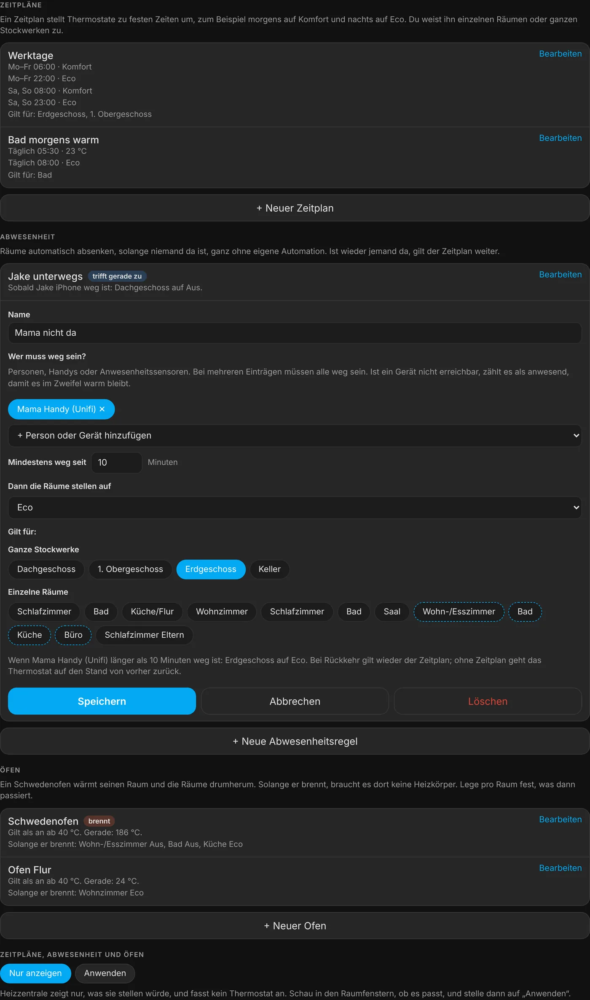

# Abwesenheit

Mit einer Abwesenheitsregel werden Räume abgesenkt oder ausgeschaltet,
solange bestimmte Personen oder Geräte weg sind. Du brauchst dafür keine
Automation.

{ loading=lazy }

## Anlegen

1. Unter dem Zahnrad im Abschnitt **Abwesenheit** auf **Neue
   Abwesenheitsregel**.
2. **Wer muss weg sein?** Personen, Handys (Geräte-Tracker), Anwesenheits-
   oder Verbindungssensoren oder Schalter-Helfer wählen.
3. **Mindestens weg seit** in Minuten einstellen, zum Beispiel 10.
4. Die **Aktion** wählen, etwa Eco, Abwesend oder Aus.
5. Stockwerke oder Räume wählen und speichern.

Beispiele:

- „Sobald Jake iPhone weg ist: Dachgeschoss auf Aus.“
- „Wenn Mama Handy länger als 10 Minuten weg ist: Erdgeschoss auf Eco.“

## Regeln

- Bei mehreren Einträgen müssen **alle** weg sein.
- Personen und Geräte-Tracker zählen als anwesend, wenn sie `home` sind.
  Alles andere zählt als anwesend, wenn es `on` ist.
- Ist ein Gerät **nicht erreichbar oder unbekannt**, zählt es als anwesend.
  Im Zweifel bleibt es warm.
- Eine aktive Regel hat **Vorrang** vor Ofen und Zeitplan.
- Bei Rückkehr gilt wieder der Zeitplan. Hat der Raum keinen Zeitplan, geht
  das Thermostat auf den Stand von vorher zurück.
- Nach einem Neustart von Home Assistant bleibt eine Regel aktiv, solange
  alle weiterhin weg sind.

Auch Abwesenheitsregeln wirken erst, wenn in den Einstellungen **Anwenden**
gewählt ist. Bis dahin steht im Raumfenster, was passieren würde.
