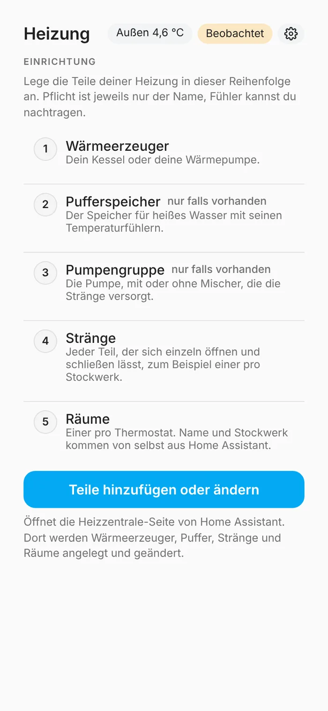

# Einrichtung

Die Anlage beschreibst du in fünf Schritten. Jeder Schritt ist ein Teil, das
du auf der Seite der Integration über die Schaltflächen hinzufügst. Die
Ansicht selbst zeigt dir unter dem Zahnrad, welche Schritte noch fehlen.

{ width=320 loading=lazy }

Fast alle Felder sind optional. Was du nicht hast, lässt du leer. Alles lässt
sich später ändern.

## 1. Wärmeerzeuger

Kessel, Wärmepumpe oder ein anderes Gerät, das Wärme erzeugt.

| Feld | Bedeutung |
| --- | --- |
| Art | Nur für das Bild und spätere Auswertungen. |
| Kesseltemperatur | Temperatur des Wassers im Kessel, typisch 50 bis 80 °C. |
| Vorlauftemperatur | Temperatur des Wassers, das zur Heizung geht, falls du dafür einen eigenen Fühler hast. |
| Status | Eine beliebige Entität, die zeigt, ob der Wärmeerzeuger läuft. |

!!! tip "Flammraumtemperatur"
    Die Flammraum- oder Feuerraumtemperatur ist die Temperatur im Feuer und
    liegt bei mehreren hundert Grad. Sie gehört nicht ins Feld
    Kesseltemperatur. Du kannst sie später als
    [zusätzlichen Fühler](hausansicht.md#zusatzliche-fuhler) an die Kachel
    hängen.

## 2. Puffer (optional)

Der Pufferspeicher mit seinen Temperaturfühlern von oben nach unten und,
wenn du magst, dem Volumen in Litern.

## 3. Pumpengruppe (optional)

Die Pumpe mit Mischer, die den Verteiler mit gemischtem Wasser versorgt.

| Feld | Bedeutung |
| --- | --- |
| Vorlauf, Rücklauf | Fühler hinter dem Mischer. |
| Status | Zeigt, ob die Pumpe läuft. |
| Steuer-Entität | Womit sich die Pumpengruppe ein- und ausschalten lässt: ein Schalter, ein Thermostat oder eine Auswahl mit Modi. |

Ist die Steuer-Entität eine Auswahl mit Modi, fragt ein zweiter Schritt,
welcher Modus **Aus** und welcher **An** bedeutet, zum Beispiel `0_aus` und
`1_auto`. Steht die Auswahl später in einem anderen Modus, den jemand von
Hand gewählt hat, lässt Heizzentrale sie in Ruhe.

## 4. Stränge

Ein Strang ist eine Leitung vom Verteiler zu einer Gruppe von Heizkörpern,
oft ein Stockwerk.

| Feld | Bedeutung |
| --- | --- |
| Art | Zweirohr, Einrohr, Fußbodenheizung oder anderes. |
| Vorlauf, Rücklauf | Fühler am Strang. Daraus entsteht die Spreizung. |
| Stellantrieb | Schalter oder Ventil, das den Strang öffnet und schließt. |
| Bauart | Stromlos zu (NC) oder stromlos offen (NO). |
| Pumpengruppe | Welche Pumpengruppe den Strang versorgt. |

## 5. Räume

Ein Raum braucht nur sein Thermostat. Name, Strang, Stockwerk und
Fensterkontakte sind optional.

- Der **Name** kommt sonst aus dem Bereich des Thermostats.
- Das **Stockwerk** kommt aus Home Assistant: Der Bereich des Thermostats
  muss dort einem Stockwerk zugeordnet sein.
- Du kannst **mehrere Fensterkontakte** je Raum wählen.

## Sprache

Unter dem Zahnrad kannst du die Ansicht auf Deutsch, Englisch oder „wie Home
Assistant“ stellen. Die Einrichtungsdialoge selbst folgen immer der Sprache
in deinem Benutzerprofil.
