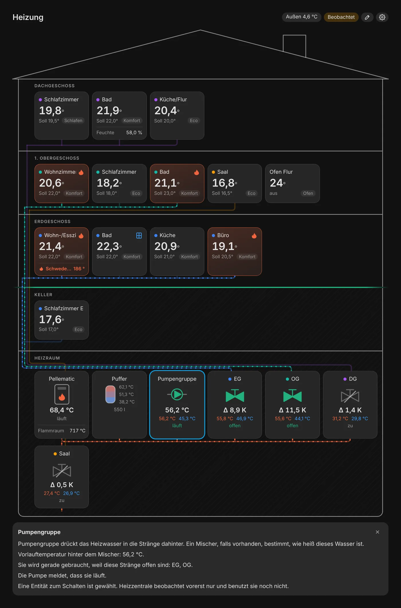
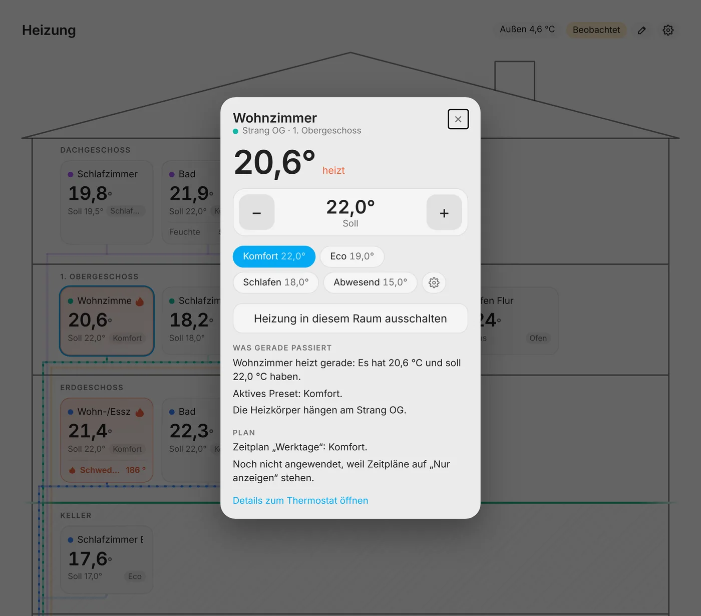
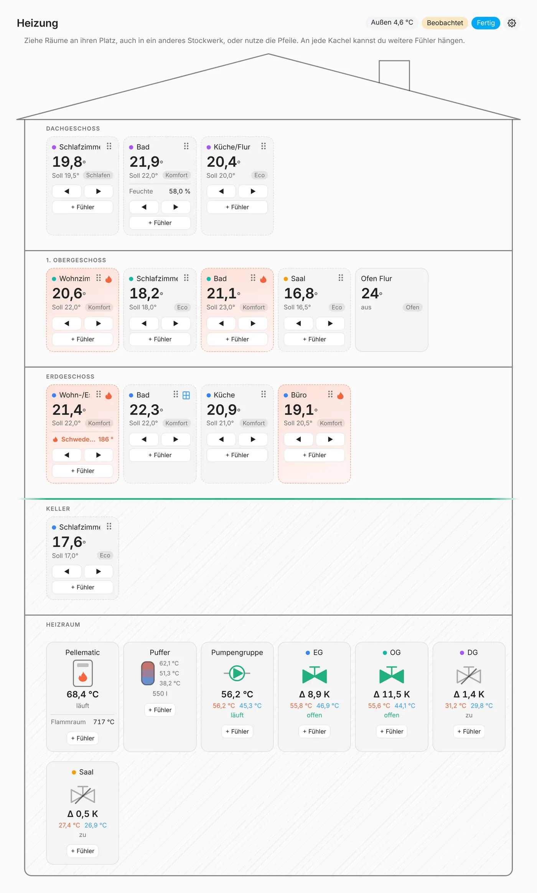
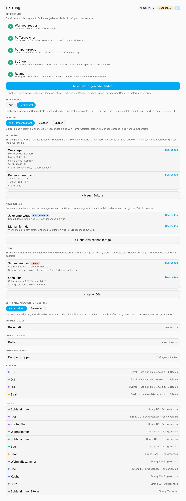

# Hausansicht

{ loading=lazy }

## Wo finde ich sie

- **Seitenleiste**: Der Eintrag **Heizzentrale** zeigt die Ansicht als ganze
  Seite.
- **Dashboard**: Karte hinzufügen und nach **Heizzentrale** suchen, oder von
  Hand:

```yaml
type: custom:heizzentrale-house-card
```

Mit mehreren Anlagen wählst du im Karteneditor, welche gezeigt wird.

## Aufbau

- Oben das Haus mit einem Abschnitt je Stockwerk, darunter die grüne
  Erdlinie, der Keller und der **Heizraum**.
- Jeder Strang hat eine Farbe. Die Leitungen laufen vom Strang zu seinen
  Räumen. Punkte bewegen sich, solange der Strang offen ist.
- Eine Raumkachel zeigt Isttemperatur, Solltemperatur und Preset. Eine
  Flamme heißt, dass der Raum gerade heizt, ein Fenstersymbol, dass ein
  Fenster offen ist.

## Etwas anklicken

Ein Klick auf Kessel, Puffer, Pumpengruppe oder Strang öffnet eine
Erklärung in einfachen Worten.

Ein Klick auf einen Raum öffnet das Raumfenster:

{ loading=lazy }

Dort stellst du die Solltemperatur, wählst ein Preset oder schaltest die
Heizung im Raum aus. Das wirkt direkt auf das Thermostat, so als würdest du
es in Home Assistant bedienen. Unter **Plan** steht, was Zeitplan,
Abwesenheit oder Ofen für diesen Raum gerade vorsehen.

## Haus anordnen

Der Stift oben rechts startet den Bearbeitungsmodus.

{ loading=lazy }

- **Räume verschieben**: mit der Maus ziehen, am Handy am Griff ⠿ ziehen,
  oder die Pfeile nutzen. Du kannst einen Raum auch in ein anderes Stockwerk
  ziehen. Er folgt dann den Zeitplänen dieses Stockwerks.
- **Fertig** beendet den Modus. Die Anordnung gilt für alle Nutzer.

## Zusätzliche Fühler

Im Bearbeitungsmodus hat jede Kachel die Schaltfläche **+ Fühler**. Damit
hängst du weitere Sensoren an einen Raum oder ein Teil im Heizraum, zum
Beispiel Luftfeuchte im Bad oder die Flammraumtemperatur am Kessel. Eine
kurze Beschriftung ist optional.

## Einstellungen

Das Zahnrad öffnet die Einstellungen: Einrichtung, Betriebsmodus, Sprache,
[Zeitpläne](zeitplaene.md), [Abwesenheit](abwesenheit.md), [Öfen](oefen.md)
und eine Übersicht aller Teile mit Hinweisen, wo noch etwas fehlt.

{ loading=lazy }
