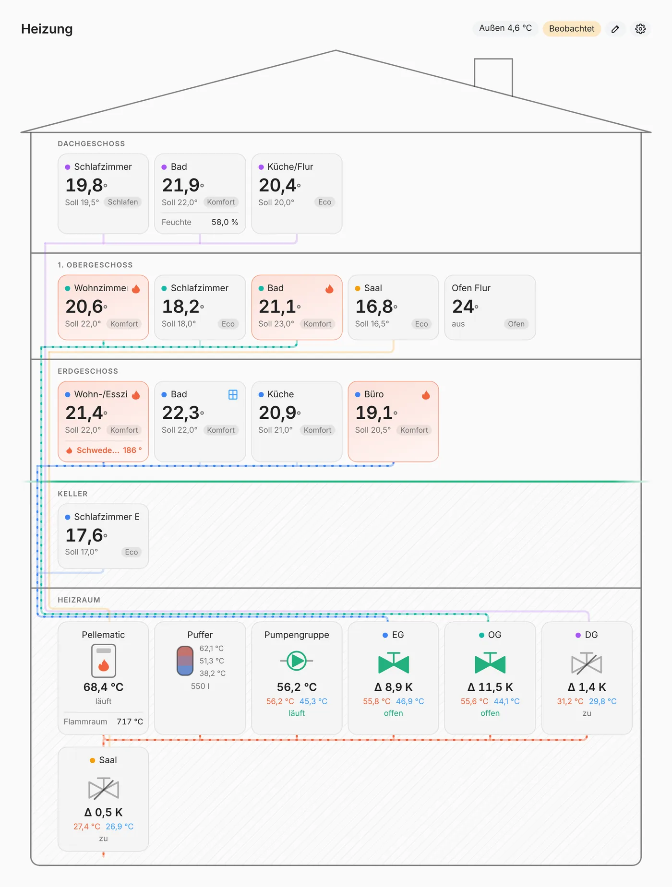

# Heizzentrale

Heizzentrale ist eine Integration für Home Assistant. Sie zeigt deine
wassergeführte Heizung als Haus im Querschnitt: Wärmeerzeuger, Puffer,
Pumpengruppe, Stränge und Räume, mit animierten Leitungen. Dazu kommen
Zeitpläne, Abwesenheitsregeln und Ofenregeln, die du direkt in der Ansicht
anlegst, ganz ohne eigene Automationen.

!!! warning "Beta"
    Diese Version ist eine Beta. Sie ist zum Ausprobieren gedacht. Texte,
    Aussehen und Funktionen können sich noch ändern. Stränge und Pumpen
    werden noch **nicht** geschaltet, Heizzentrale zeigt dort nur, was sie
    tun würde. Thermostate werden nur umgestellt, wenn du das ausdrücklich
    einschaltest.

{ loading=lazy }

## Was sie kann

- **Hausansicht**: ein Stockwerk je Etage aus Home Assistant, jede Raumkachel
  mit Ist- und Solltemperatur, darunter der Heizraum mit Kessel, Puffer,
  Pumpengruppe und Strängen.
- **Erklärungen**: ein Klick auf ein Teil sagt in einfachen Worten, was dort
  gerade passiert und warum.
- **Raumfenster**: Solltemperatur, Preset und Ein/Aus direkt am Raum.
- **Zeitpläne** für einzelne Räume oder ganze Stockwerke.
- **Abwesenheit**: Räume absenken, wenn bestimmte Personen oder Handys weg
  sind.
- **Öfen**: Räume absenken oder ausschalten, solange ein Schwedenofen brennt.
- **Anordnen**: Räume per Ziehen sortieren und zusätzliche Fühler an jede
  Kachel hängen.
- **Vorschau aufs Schalten**: an jedem Strang steht, ob er gerade gebraucht
  wird und was Heizzentrale schalten würde.

## Für wen

Für Heizungen mit Wasser als Wärmeträger: Kessel oder Wärmepumpe, optional
Puffer, ein oder mehrere Stränge mit oder ohne Stellantrieb, Räume mit
Thermostaten, die es in Home Assistant als `climate` gibt. Nichts davon ist
auf einen Hersteller festgelegt.

## Weiter

1. [Installation](installation.md)
2. [Einrichtung](einrichtung.md) in fünf Schritten
3. [Hausansicht](hausansicht.md) kennenlernen
