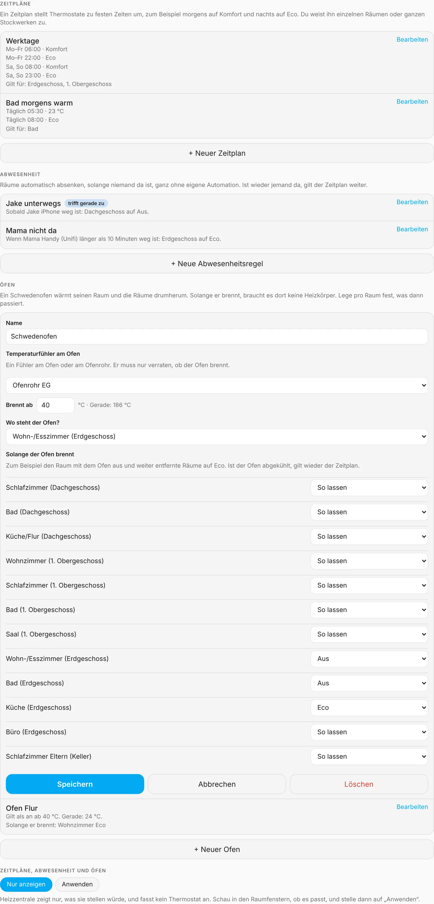

# Öfen

Ein Schwedenofen wärmt seinen Raum und die Räume drumherum. Solange er
brennt, braucht es dort keine Heizkörper. Mit einer Ofenregel legst du je
Raum fest, was dann passiert.

{ loading=lazy }

## Anlegen

1. Unter dem Zahnrad im Abschnitt **Öfen** auf **Neuer Ofen**.
2. Den **Temperaturfühler am Ofen** wählen.
3. **Brennt ab** einstellen: ab welcher Temperatur der Ofen als an gilt.
   Daneben steht der aktuelle Wert des Fühlers.
4. **Wo steht der Ofen?** Entweder in einem Raum, dann erscheint er in
   dessen Kachel. Oder als eigene Kachel in einem Stockwerk, zum Beispiel
   für einen Ofen im Flur ohne Thermostat.
5. Je Raum wählen, was passiert, solange er brennt. Zum Beispiel das
   Wohnzimmer aus, das Bad daneben aus und weiter entfernte Räume auf Eco.

## Regeln

- Der Ofen gilt als **aus**, wenn er 5 Grad unter die Schwelle gefallen ist.
  So schalten Räume nicht hin und her, wenn der Wert um die Schwelle pendelt.
- Liefert der Fühler keinen Wert, gilt der Ofen als aus. Die Heizkörper
  arbeiten dann normal.
- Vorrang: Abwesenheit vor Ofen vor Zeitplan.
- Ist der Ofen abgekühlt, gilt wieder der Zeitplan, sonst der Stand von
  vorher.

## Welcher Fühler

Der Fühler muss nur verraten, ob der Ofen brennt.

- **Neben dem Ofen**: Übliche Kabelfühler (DS18B20, etwa am Shelly Add-on)
  und Zigbee-Fühler vertragen nur gut 100 °C. Befestige sie mit Abstand,
  zum Beispiel an der Wand hinter dem Ofen, und stelle die Schwelle niedrig
  ein, etwa 35 °C.
- **Direkt am Ofenrohr**: Dafür braucht es ein Thermoelement Typ K, zum
  Beispiel an einem ESP32 mit MAX31855 und ESPHome.

Prüfe vor dem Kauf die Temperaturangabe des Herstellers für Fühler **und**
Kabel.
