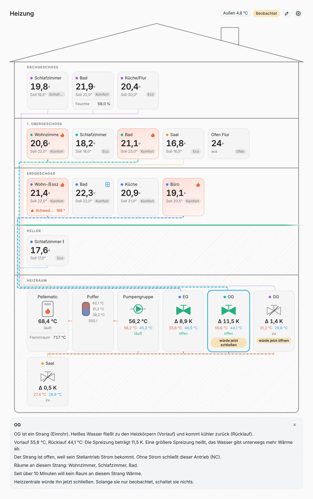

# Stränge und Pumpe schalten

Heizzentrale rechnet laufend aus, welche Stränge gebraucht werden, und zeigt
das an. **Solange der Betriebsmodus auf „Beobachtet“ steht, schaltet sie
dabei nichts.** Du kannst in Ruhe prüfen, ob ihre Entscheidungen zu deinem
Haus passen, und danach auf „Schaltet“ stellen.

{ loading=lazy }

## So entscheidet sie

**Ein Raum will Wärme**, wenn sein Thermostat an ist, kein Fenster offen ist
und es Heizen meldet. Meldet ein Thermostat das nicht, zählt, ob der Raum
mehr als 0,2 Grad unter seinem Soll liegt.

**Ein Strang wird gebraucht**, solange mindestens einer seiner Räume Wärme
will.

- Will kein Raum mehr Wärme, wartet sie **10 Minuten**. Erst dann steht am
  Strang „würde jetzt schließen“.
- Will ein Raum wieder Wärme, steht dort sofort „würde jetzt öffnen“.
- Ein Strang **ohne zugeordnete Räume** gilt immer als gebraucht.
- Ist ein Thermostat **nicht lesbar**, bleibt der Strang sicherheitshalber
  offen.

**Die Pumpengruppe wird gebraucht**, solange einer ihrer Stränge gebraucht
wird. Sind alle zu, steht dort „würde jetzt ausschalten“. Steht ihre
Steuer-Entität in einem Modus, den jemand von Hand gewählt hat, bleibt sie
unangetastet.

Ein Klick auf den Strang oder die Pumpengruppe nennt den Grund in Worten.

## Betriebsmodus

Den Modus wählst du in den Einstellungen der Ansicht.

| Modus | Bedeutung |
| --- | --- |
| Aus | Heizzentrale zeigt nur Messwerte. |
| Beobachtet | Sie zeigt zusätzlich, was sie schalten würde. Das ist der Standard. |
| Schaltet | Sie schließt und öffnet Stränge und schaltet die Pumpengruppe. |

„Schaltet“ musst du ein zweites Mal bestätigen. Zeitpläne, Abwesenheit und
Öfen haben ihren eigenen Schalter „Nur anzeigen / Anwenden“ und sind davon
unabhängig.

## Was im Modus „Schaltet“ gilt

- **Öffnen geht vor.** Braucht ein Raum Wärme, wird sein Strang sofort
  geöffnet, auch wenn ihn jemand von Hand geschlossen hat.
- **Geschlossen wird einmal.** Öffnest du einen Strang von Hand, den
  Heizzentrale geschlossen hat, bleibt er offen, bis wieder ein Raum Wärme
  braucht und der Bedarf danach erneut endet.
- **Reihenfolge:** Erst öffnet der Strang, dann startet die Pumpengruppe.
  Beim Abschalten stoppt erst die Pumpengruppe, dann schließt der Strang.
- **Die Pumpengruppe wird nur wieder eingeschaltet, wenn Heizzentrale sie
  selbst ausgeschaltet hat.** Hast du die Heizung von Hand ausgeschaltet,
  bleibt sie aus.
- **Frostschutz:** Ein Raum unter 8 °C zählt immer als „will Wärme“, egal
  wie sein Thermostat steht. Sein Strang bleibt offen.
- **Zurück auf „Beobachtet“ oder „Aus“:** Alles, was Heizzentrale
  geschlossen oder ausgeschaltet hat, wird wieder geöffnet und
  eingeschaltet.
- **Nach einem Neustart** von Home Assistant fasst sie nichts an, bis der
  gespeicherte Modus wieder geladen ist.

!!! warning "Wenn Home Assistant ausfällt"
    Fällt Home Assistant aus, während ein Strang geschlossen ist, bleibt er
    geschlossen, bis Home Assistant wieder läuft. Eine Überwachung direkt im
    Stellantrieb-Schalter, die dann von selbst öffnet, ist geplant. Für
    Stränge, die nie kalt werden dürfen, eignen sich stromlos offene
    Antriebe (NO).
