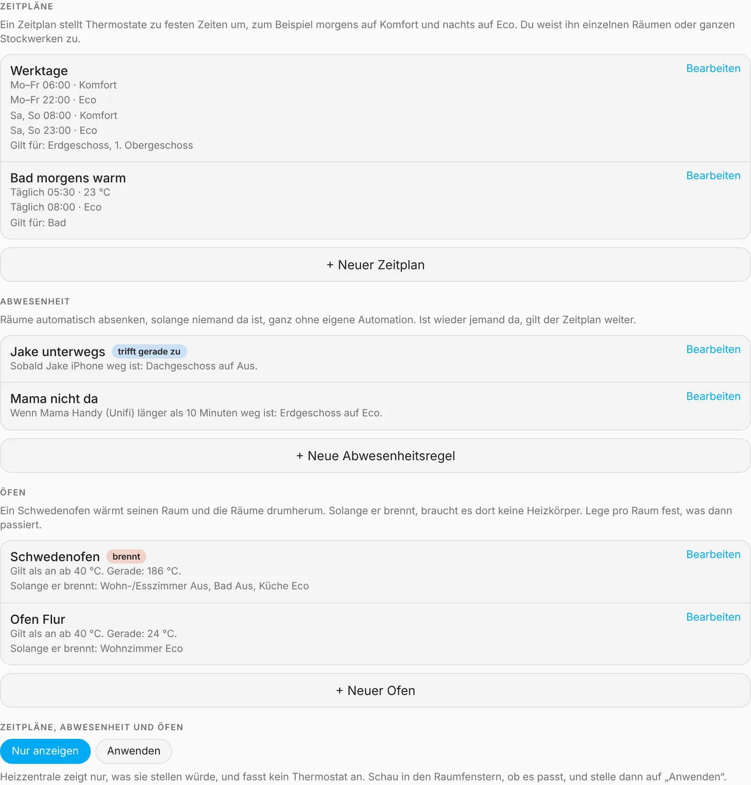
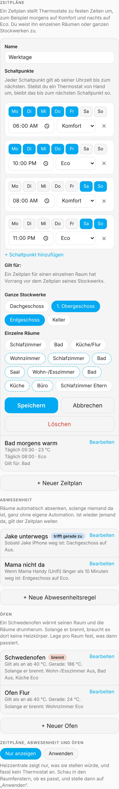

# Zeitpläne

Ein Zeitplan stellt Thermostate zu festen Zeiten um. Du findest ihn unter
dem Zahnrad im Abschnitt **Zeitpläne**.

{ loading=lazy }

## Anlegen

1. **Neuer Zeitplan** wählen und einen Namen geben.
2. **Schaltpunkte** hinzufügen. Jeder Schaltpunkt hat Wochentage, eine
   Uhrzeit und eine Aktion.
3. Unter **Gilt für** Stockwerke oder einzelne Räume antippen.
4. **Speichern**.

{ width=320 loading=lazy }

## Aktionen

| Aktion | Wirkung |
| --- | --- |
| Ein Preset, etwa Komfort, Eco, Schlafen | Stellt das Preset am Thermostat. Angeboten werden die Presets deiner Thermostate. |
| An | Schaltet das Thermostat ein, ohne sonst etwas zu ändern. |
| Aus | Schaltet das Thermostat aus. |
| Temperatur | Stellt eine feste Solltemperatur. |

## Regeln

- Ein Schaltpunkt gilt ab seiner Uhrzeit bis zum nächsten. Die Woche läuft
  durch: Montag früh gilt noch der letzte Punkt vom Sonntag.
- Ein Zeitplan für einen **einzelnen Raum hat Vorrang** vor dem seines
  Stockwerks.
- Stellst du ein Thermostat **von Hand** um, bleibt das bis zum nächsten
  Schaltpunkt so.
- Bietet ein Thermostat ein Preset nicht an, wird es dort ausgelassen.

## Erst ansehen, dann anwenden

Zeitpläne starten auf **Nur anzeigen**. Heizzentrale fasst dann kein
Thermostat an und schreibt im Raumfenster unter **Plan**, was sie stellen
würde. Passt das, stellst du ganz unten in den Einstellungen auf
**Anwenden**.

!!! warning "Eigene Automationen"
    Schalte Automationen ab, die dieselben Thermostate zeitlich steuern,
    bevor du auf Anwenden stellst. Sonst arbeiten beide gegeneinander.
